<div align="center">

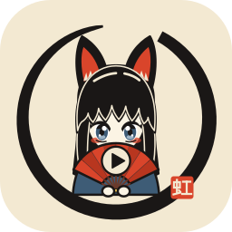

# Nijiyome

**Anime, manga y novelas para Android, Linux y Windows, con tus propias extensiones y tus listas de AniList o MyAnimeList.**

[English](README.md) · **Español**

[](https://github.com/Kushro/Nijiyome/releases/latest)
[](LICENSE)


</div>

Nijiyome es una sola base de código en Kotlin + Compose Multiplatform que corre en teléfonos y tablets Android y en
escritorios Linux y Windows. Reproduce con libmpv, mantiene tus listas sincronizadas con AniList o MyAnimeList y obtiene los
streams de extensiones `.kai` que tú eliges e instalas. **La app no trae contenido.**

## 📸 Capturas

### Direcciones visuales (Escritorio)

Elige entre cinco direcciones visuales independientes — **Tanabata**, **Obi**, **Tránsito nocturno**, **Sumi y hanko** y **Material** — y combina cualquiera con 16 estilos de tarjeta, paletas curadas (claro, oscuro y OLED), perfiles de movimiento y estructuras configurables por pantalla.

<table>
  <tr>
    <td align="center" valign="top">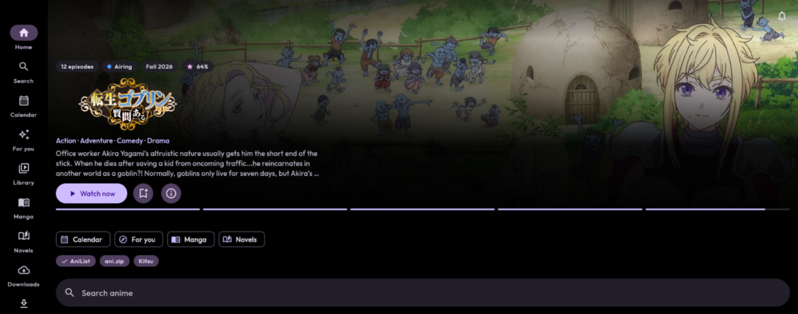<br><sub>Tanabata — Inicio (Esta noche)</sub></td>
    <td align="center" valign="top">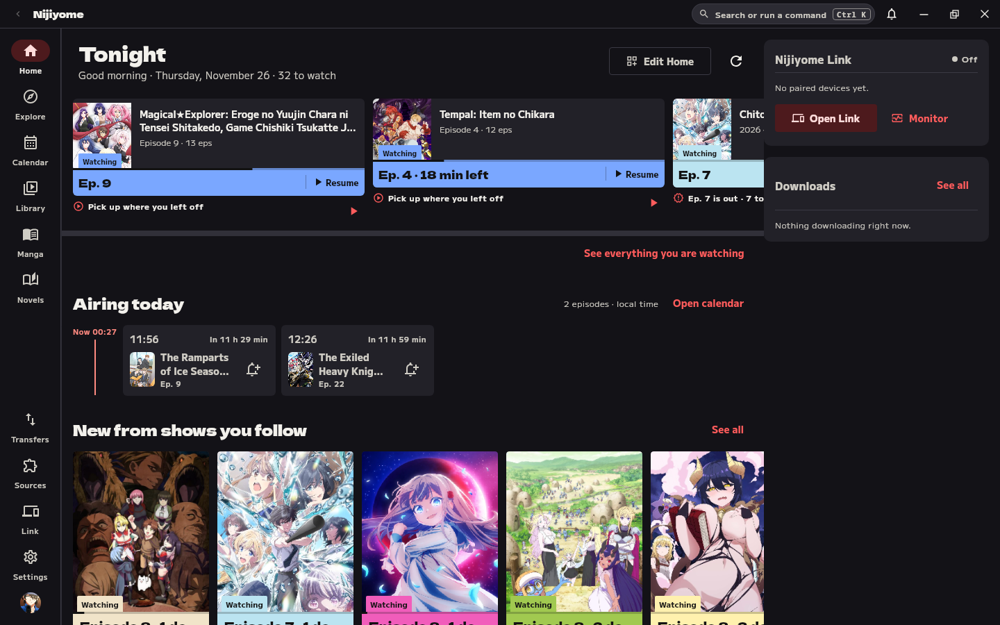<br><sub>Obi — Inicio (Esta noche)</sub></td>
  </tr>
  <tr>
    <td align="center" valign="top">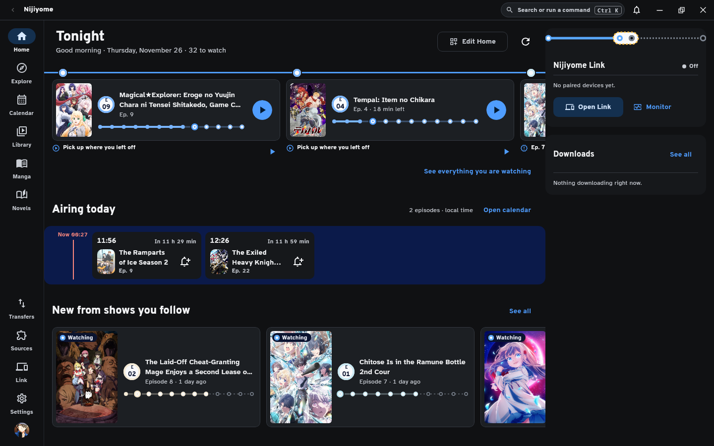<br><sub>Tránsito nocturno — Inicio (Esta noche)</sub></td>
    <td align="center" valign="top">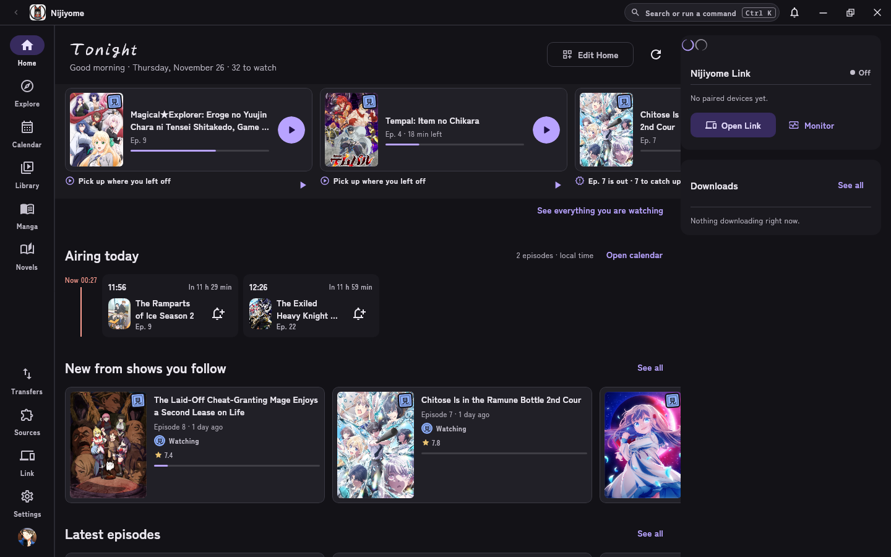<br><sub>Sumi y hanko — Inicio (Esta noche)</sub></td>
  </tr>
</table>

### Pantallas de escritorio

<table>
  <tr>
    <td align="center" valign="top">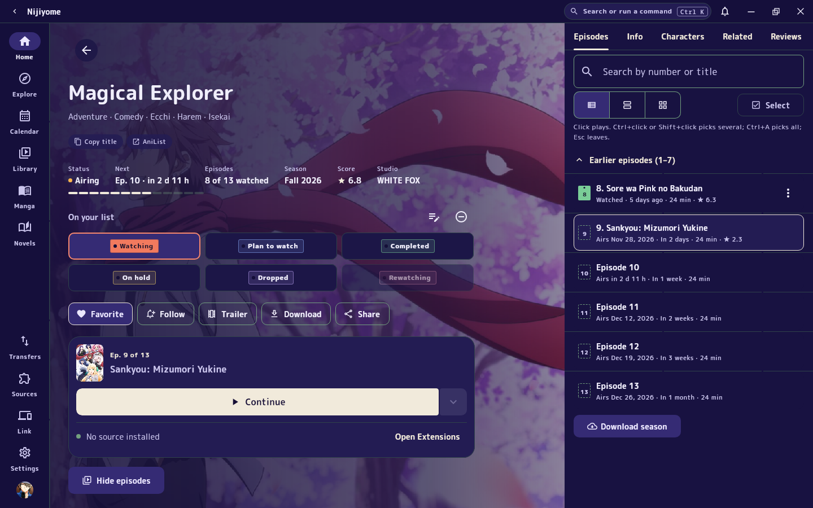<br><sub>Ficha de anime (estructura Cine)</sub></td>
    <td align="center" valign="top">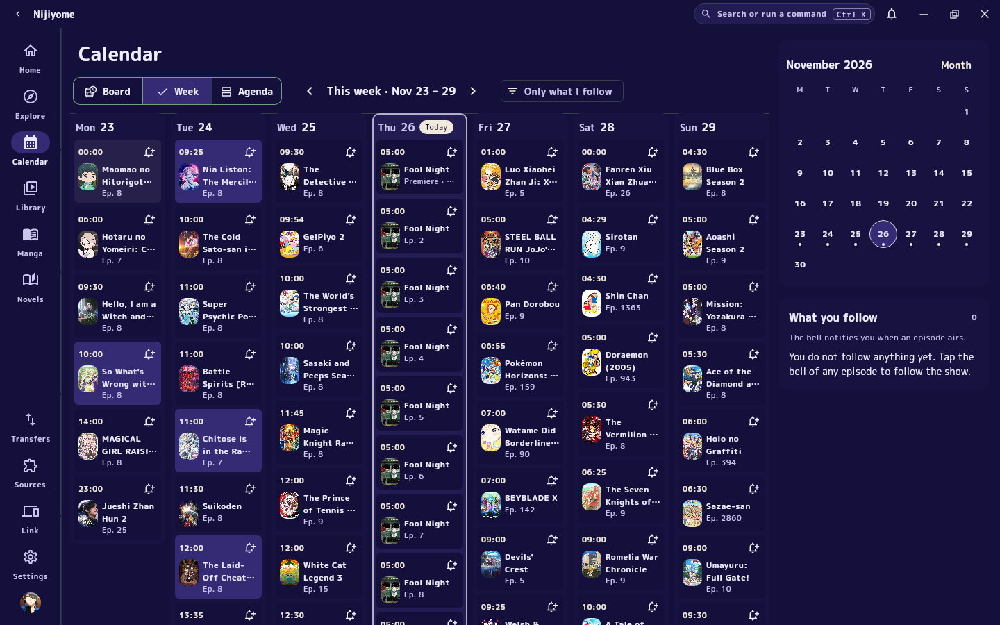<br><sub>Calendario (Semana, 24 h)</sub></td>
  </tr>
  <tr>
    <td align="center" valign="top">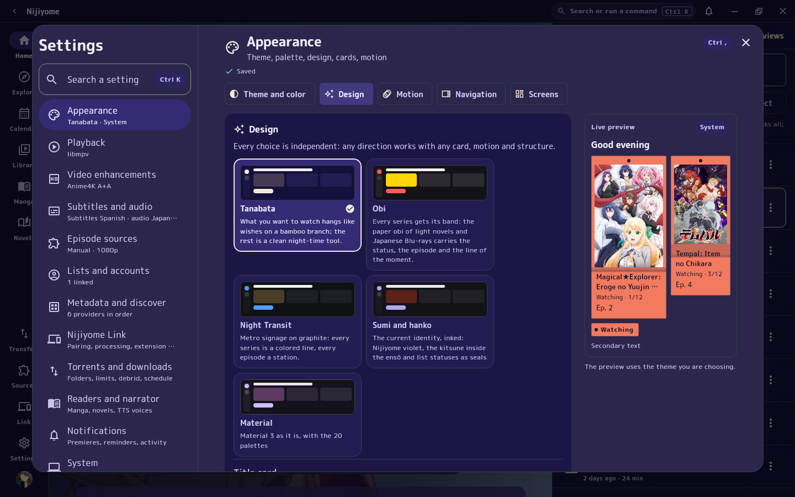<br><sub>Ajustes › Apariencia › Diseño</sub></td>
    <td align="center" valign="top">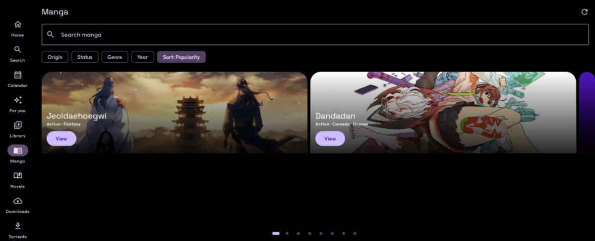<br><sub>Catálogo de Manga</sub></td>
  </tr>
  <tr>
    <td align="center" valign="top">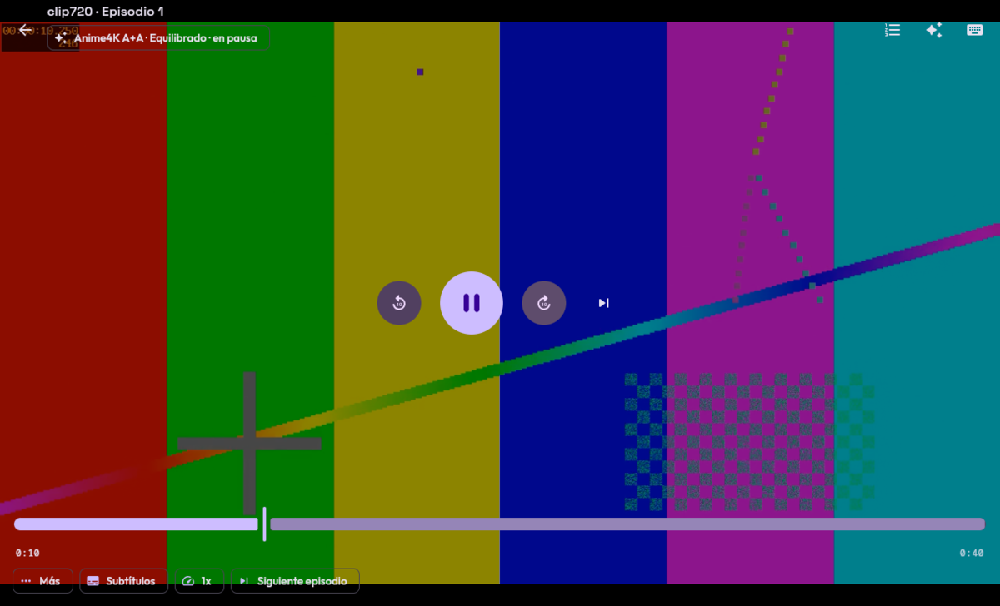<br><sub>Reproductor integrado con Anime4K</sub></td>
    <td align="center" valign="top">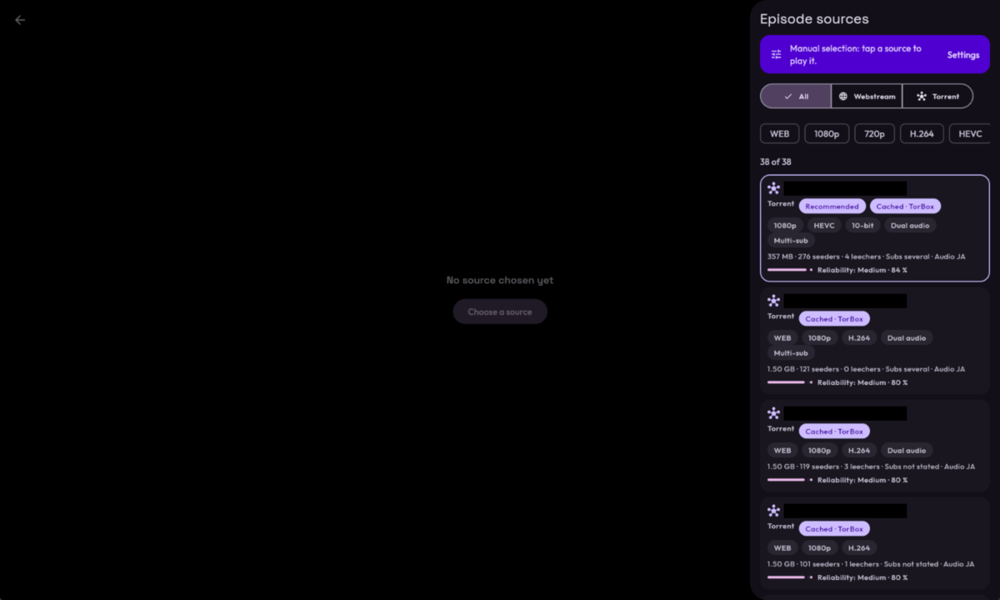<br><sub>Fuentes del episodio (en caché de TorBox)</sub></td>
  </tr>
  <tr>
    <td align="center" valign="top">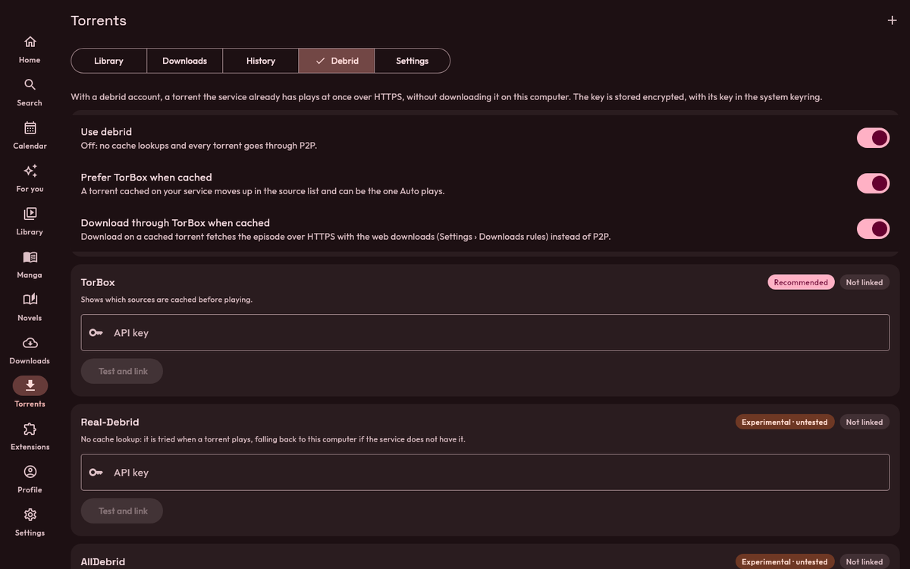<br><sub>Torrents › Debrid</sub></td>
    <td align="center" valign="top">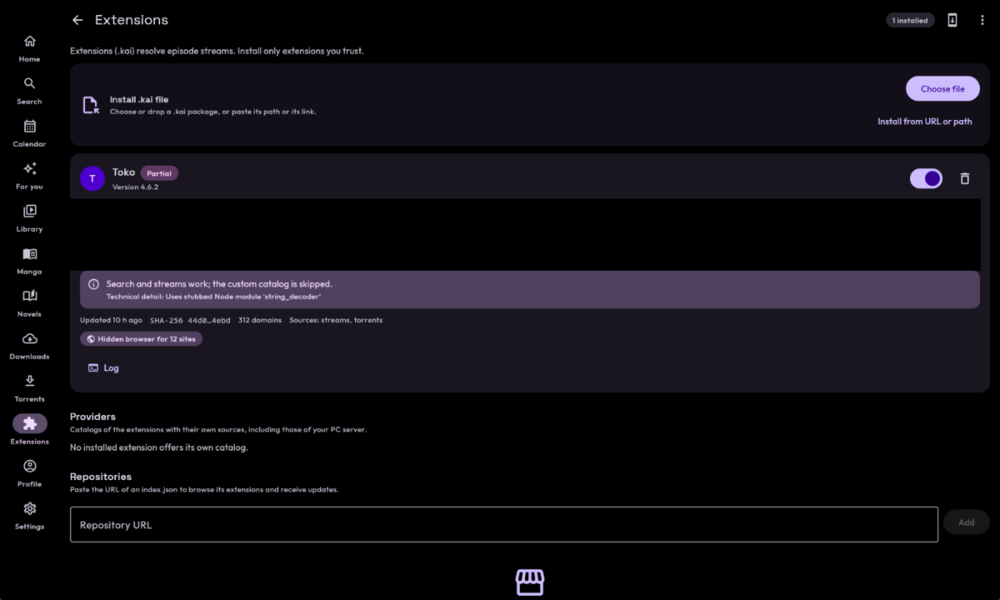<br><sub>Extensiones</sub></td>
  </tr>
</table>

### Nijiyome Link

<table>
  <tr>
    <td align="center" valign="top" width="68%">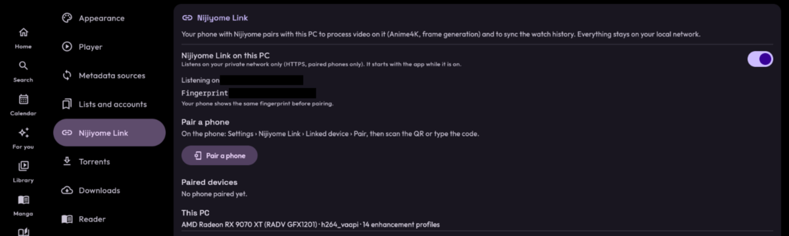<br><sub>Escritorio: Ajustes › Nijiyome Link</sub></td>
    <td align="center" valign="top" width="32%">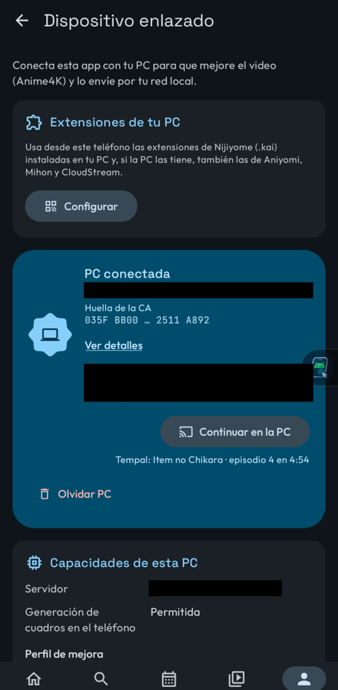<br><sub>Android: dispositivo vinculado</sub></td>
  </tr>
</table>

<p align="center">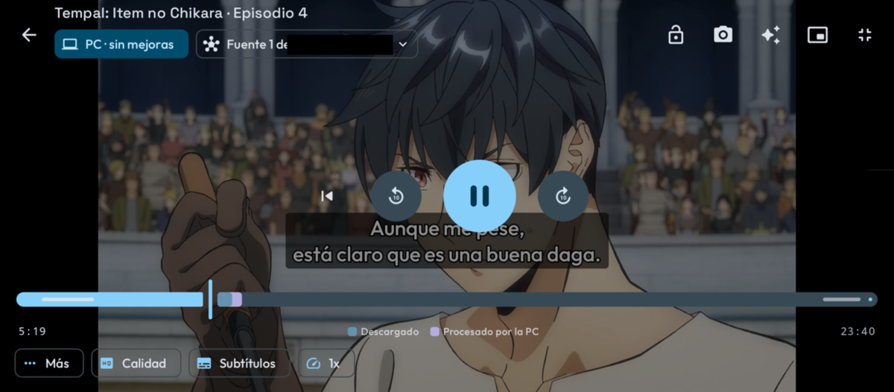<br><sub>Reproductor de Android, episodio procesado por la PC con Nijiyome Link</sub></p>

### Android

<p align="center">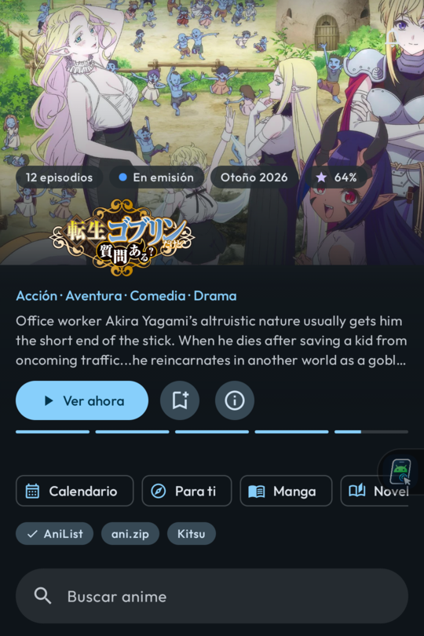<br><sub>Android: Inicio</sub></p>

<sub>Versión 1.3.2, capturas reales en escritorio (Linux) y Android. Algunos nombres en capturas anteriores del reproductor y extensiones están tapados con barras negras a propósito: nombres de fuentes y sitios, y datos de red.</sub>

## ✨ Funciones

- 🧩 **Extensiones `.kai`.** Se instalan desde un archivo, un enlace o un repositorio (`index.json`), y la app muestra los
  dominios que declaran antes de usarlas. Las extensiones hechas para Tatakai siguen funcionando. También se pueden agregar
  manifiestos de addons de Stremio.
- 📋 **AniList y MyAnimeList.** Vincula tu cuenta para sincronizar listas y progreso; el descubrimiento, el calendario y las
  fichas vienen de AniList y otras fuentes de metadatos.
- 🎬 **Reproductor libmpv.** Subtítulos ASS completos, deband y ajustes de imagen, y shaders de escalado: Anime4K (varios
  modos y niveles de calidad), FSR, FSRCNNX, CAS y NVScaler, que bajan de nivel solos si la GPU no da abasto.
- ✨ **Generación de cuadros integrada (escritorio y Android).** Corre LSFG 3.1 / 3.1P directamente dentro del reproductor
  integrado de Nijiyome usando tu propio `Lossless.dll` (zero-copy OpenGL↔Vulkan en Linux, zero-copy D3D12↔Vulkan en Windows
  y respaldo automático), con multiplicador en vivo (`×2`–`×4`), modo rendimiento, anti-artefactos en cortes de escena y
  compensación automática de audio, sin necesidad de ventana externa de mpv.
- ⚡ **Decodificación por hardware.** VAAPI en Linux (los ajustes muestran qué puede decodificar tu GPU); por software como
  respaldo.
- 🪟 **mpv externo.** Opcional: reproduce en la ventana propia de mpv con tu configuración, `mpv-anime-build` o
  [lsfg-vk](https://github.com/PancakeTAS/lsfg-vk) en Linux.
- 🧲 **Torrents.** Cliente libtorrent integrado con reproducción mientras descarga, y vistas de biblioteca, descargas,
  historial, archivos, pares y trackers. En Linux necesita glibc 2.38 o superior.
- ☁️ **Debrid.** TorBox es el servicio recomendado y probado (consulta de caché, descargas por HTTPS). Real-Debrid, AllDebrid
  y Premiumize están disponibles y marcados como *experimentales · sin probar*. Las claves de API se guardan cifradas, con la
  llave en el llavero del sistema.
- ⬇️ **Descargas y biblioteca local.** Descargas HLS y de archivos para ver sin conexión.
- 📖 **Lectores de manga y novelas.** Las novelas traen narrador con las voces del sistema o KittenTTS en escritorio.
- 🔗 **Nijiyome Link.** Empareja el teléfono con la PC: la PC puede procesar el video para el teléfono (escalado, generación
  de cuadros donde se pueda) y el historial queda sincronizado.
- 🕵️ **Navegador oculto para fuentes embed (escritorio).** Para los sitios que necesitan un navegador de verdad, Nijiyome
  maneja en segundo plano tu Chrome, Edge o Chromium instalado mediante el protocolo DevTools. No viene ninguno incluido.
- 🌐 **Red.** Proxy de salida (HTTP o SOCKS5, con credenciales) y soporte de FlareSolverr.
- 🖥️ **Integración con el escritorio.** Bandeja del sistema, Rich Presence de Discord y controles multimedia MPRIS en Linux.
- 🎨 **A tu gusto.** Cinco direcciones visuales independientes (Tanabata, Obi, Tránsito nocturno, Sumi y hanko, Material),
  16 estilos de tarjeta, paletas curadas (claro / oscuro / OLED), niveles de contraste, estructuras configurables por pantalla,
  perfiles de movimiento, paleta de comandos (`Ctrl+K`), inglés y español.

## 📦 Descarga e instalación

Todo está en [Releases](https://github.com/Kushro/Nijiyome/releases/latest), con un `SHA256SUMS.txt` para verificar los
archivos.

| Plataforma | Archivo | Notas |
|---|---|---|
| 🤖 Android 8.0+ | `Nijiyome-v1.3.2-android-arm64-v8a.apk` | La mayoría de los teléfonos de los últimos años. |
| | `Nijiyome-v1.3.2-android-armeabi-v7a.apk` | Teléfonos antiguos de 32 bits. |
| | `Nijiyome-v1.3.2-android-x86_64.apk` | Emuladores y equipos x86. |
| | `Nijiyome-v1.3.2-android-universal.apk` | Cualquier equipo, descarga más grande. Si dudas, elige este. |
| 🐧 Linux x86_64 | `Nijiyome-v1.3.2-linux-x86_64.AppImage` | Dale `chmod +x` y ejecútalo. Los torrents piden glibc 2.38+ (Ubuntu 24.04, Fedora 39, Arch o más nuevos). |
| 🪟 Windows x64 | `Nijiyome-v1.3.2-windows-x64-setup.exe` | Instalador; puede registrar los enlaces `nijiyome:` y ofrecerse para `magnet:` / `.torrent`. |
| | `Nijiyome-v1.3.2-windows-x64-portable.zip` | Descomprime y ejecuta; los datos igual van a `%APPDATA%\Nijiyome`. |

En Arch / CachyOS también puedes construir un paquete con el `PKGBUILD` de [`packaging/linux`](packaging/linux) (ver
[`packaging/README.md`](packaging/README.md)).

Después de instalar, agrega una extensión en **Extensiones** y, si quieres, vincula AniList o MyAnimeList en
**Ajustes › Listas y cuentas**.

## 🧩 Extensiones

Nijiyome no incluye, aloja ni recomienda ninguna fuente de contenido. Las extensiones son paquetes `.kai` de terceros:
instala solo extensiones en las que confíes, de orígenes en los que confíes. Cada una corre en un motor de JavaScript
integrado (QuickJS), y la app muestra los dominios que declara antes de usarla. La API del host está documentada en
[`contracts/extension-host`](contracts/extension-host).

## 🛠️ Compilar

Requisitos: JDK 21, Android SDK (plataforma 37, build-tools 36.0.0, NDK 28.2.13676358, CMake 3.22.1) y Node 22 o superior
para los tests de contratos.

```sh
cp local.properties.example local.properties   # y completar sdk.dir
./gradlew verificar                            # todos los tests, el APK debug y la distribución de escritorio
./gradlew :desktopApp:run                      # abre la app de escritorio
./gradlew :app:assembleDebug                   # solo el APK debug de Android
./gradlew :desktopApp:createReleaseDistributable  # imagen de la app de escritorio (base del AppImage y de Windows)
node --test tokens/test/*.test.mjs contracts/test/*.test.mjs
```

Los ids de cliente OAuth de AniList y MyAnimeList son opcionales para compilar; sin ellos, "Vincular" queda deshabilitado. Se
configuran en `local.properties` o por variables de entorno (`NIJIYOME_ANILIST_CLIENT_ID`, `NIJIYOME_MAL_CLIENT_ID`; los de
escritorio están en [`packaging/README.md`](packaging/README.md)), donde también está cómo se arman el AppImage y el
instalador de Windows.

<details>
<summary>Estructura del repositorio</summary>

| Ruta | Qué es |
|---|---|
| `app/` | Aplicación Android (`app.nijiyome`) |
| `desktopApp/` | Aplicación de escritorio (Linux, Windows) |
| `core/`, `feature/` | Módulos de lógica y de pantallas, compartidos por las dos apps |
| `server/` | Servidores de escritorio: Nijiyome Link (mTLS) y el servidor de extensiones integrado |
| `build-logic/` | Plugins de convención de Gradle |
| `contracts/` | Contratos compartidos: host de extensiones, Nijiyome Link v1 (OpenAPI), fixtures |
| `tokens/` | Tokens de diseño: `tokens.json` → `Tokens.kt` |
| `native/temple-lsfg/` | Helper de generación de cuadros (C++/Vulkan) para Nijiyome Link |
| `packaging/` | Empaquetado de escritorio (AppImage, paquete de Arch, instalador y zip portable de Windows) e íconos |
| `scripts/` | Herramientas de compilación y de la migración |

El plan de la migración está en [`docs/plan-migracion.md`](docs/plan-migracion.md).

</details>

## 🦊 Origen

Nijiyome continúa Tatakai Next 0.4.2, del mismo autor (`Kushro/Tatakai-own@196bfe89`), con identidad nueva y una sola base de
código para todas las plataformas. Los comentarios del código que citan `docs/redesign/…` o `apps/desktop-native/…` se
refieren a documentos y fuentes de ese repositorio.

Las extensiones `.kai` hechas para Tatakai siguen funcionando: el host conserva los nombres anteriores de sus funciones
globales como alias (ver [`contracts/extension-host/globals.v1.md`](contracts/extension-host/globals.v1.md)).

## 🤖 Sobre la IA

Soy desarrollador de software de profesión y uso la IA como herramienta durante el desarrollo, tanto para el código como para
lo visual. Cada función, la arquitectura y cada decisión de diseño de Nijiyome son mías, y todo lo que entra a la app lo
reviso y lo apruebo yo personalmente. La IA no toma las decisiones; me ayuda a construir lo que tengo en mente. Mi prioridad
siempre es la seguridad, el rendimiento y la calidad, y cada versión pasa por tests automáticos, revisiones independientes y
pruebas manuales en dispositivos reales antes de publicarse. Por ahora trabajo en esto solo, sin un artista ni un diseñador,
así que el ícono y lo visual que ves se hicieron con ayuda de IA. Cuando encuentre a alguien con quien trabajar que pueda
llevar la parte visual al nivel que se merece, esas partes podrían rehacerse. Si la IA en una app es motivo para no usarla, lo
entiendo completamente, sin rencores. Y si no lo es, me encantaría que la probaras.

— Octavio ([Kushro](https://github.com/Kushro))

## 📄 Licencia

Nijiyome es software libre bajo la **GNU Affero General Public License v3.0 o posterior**. Ver [`LICENSE`](LICENSE). El
código y las bibliotecas de terceros, con sus licencias, están en [`THIRD_PARTY_NOTICES.md`](THIRD_PARTY_NOTICES.md).

## ⚠️ Aviso

Nijiyome no está afiliado a AniList, MyAnimeList, TorBox, Real-Debrid, AllDebrid, Premiumize ni a ningún sitio de contenido,
ni cuenta con su respaldo o patrocinio. No aloja, almacena ni distribuye contenido. Las extensiones son de terceros; cada
persona es responsable de lo que instala y de cumplir las leyes de su país. Los nombres y las portadas pertenecen a sus
respectivos dueños.
