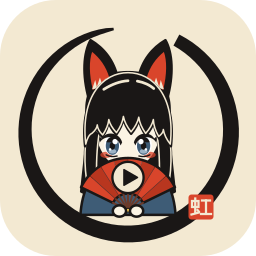
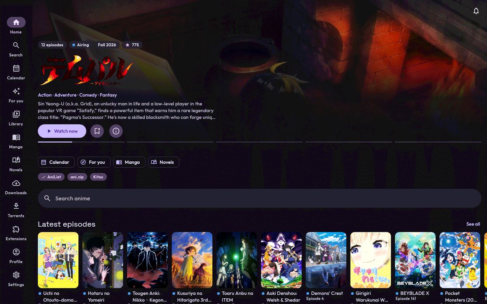
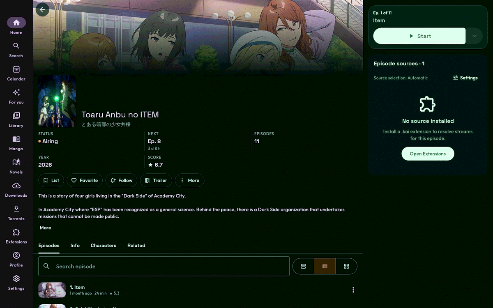
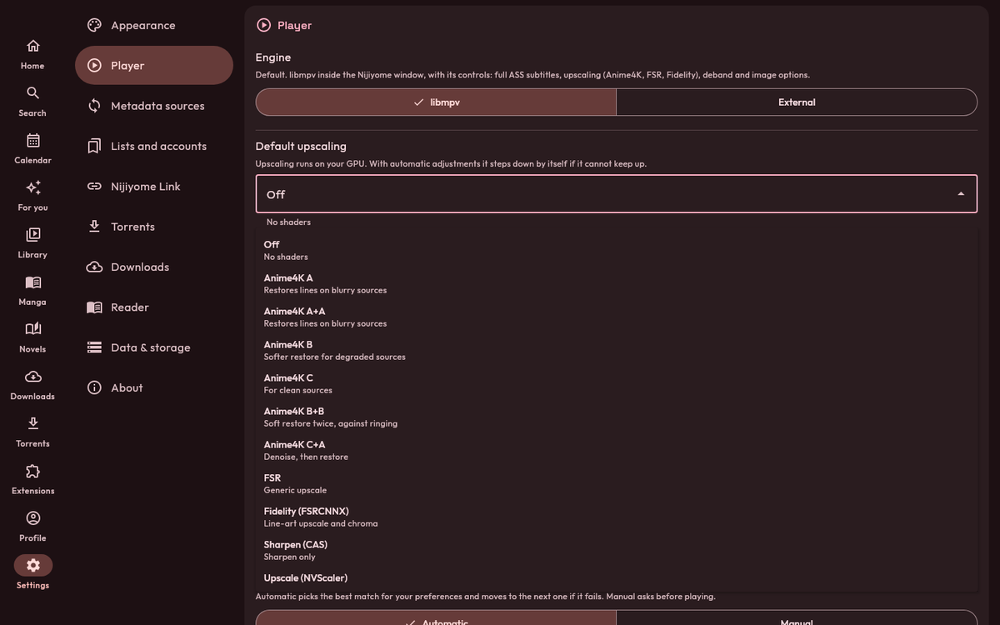
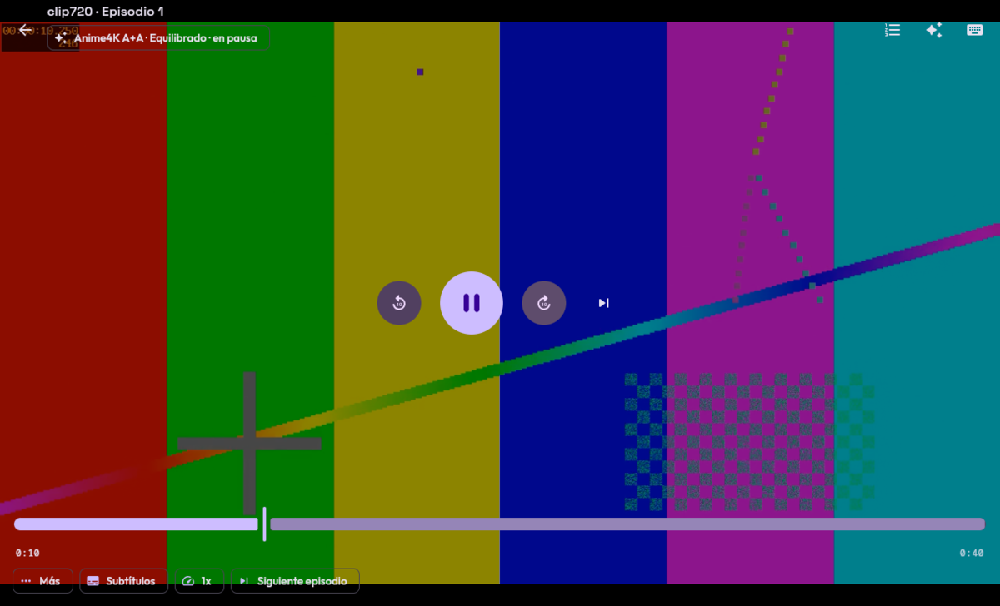
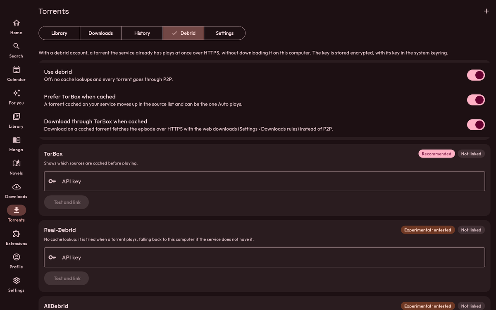
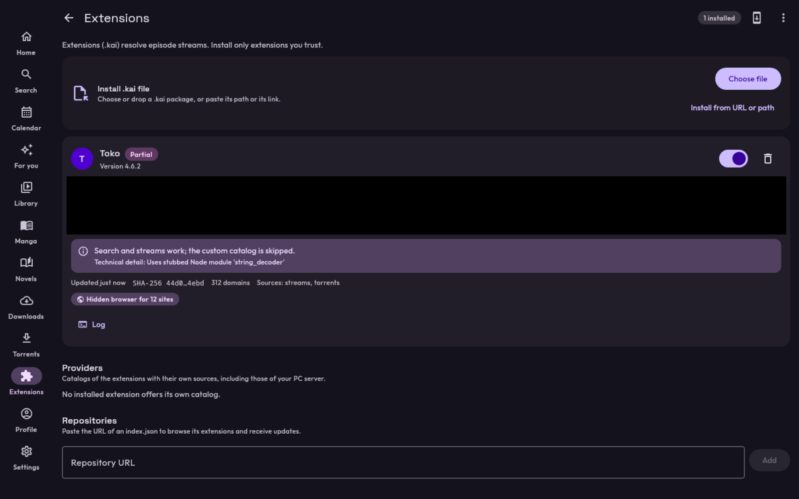
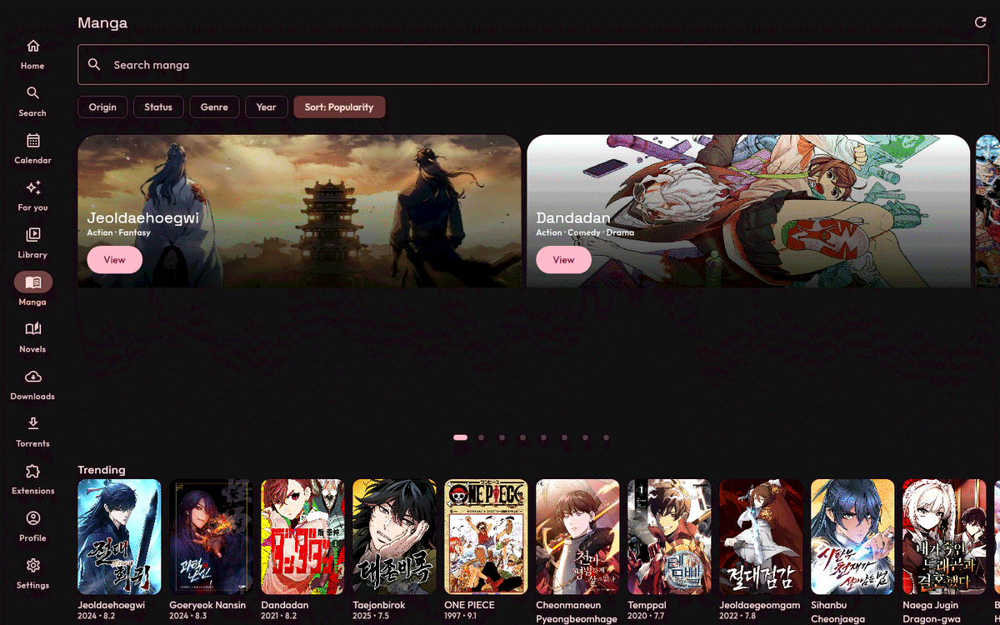
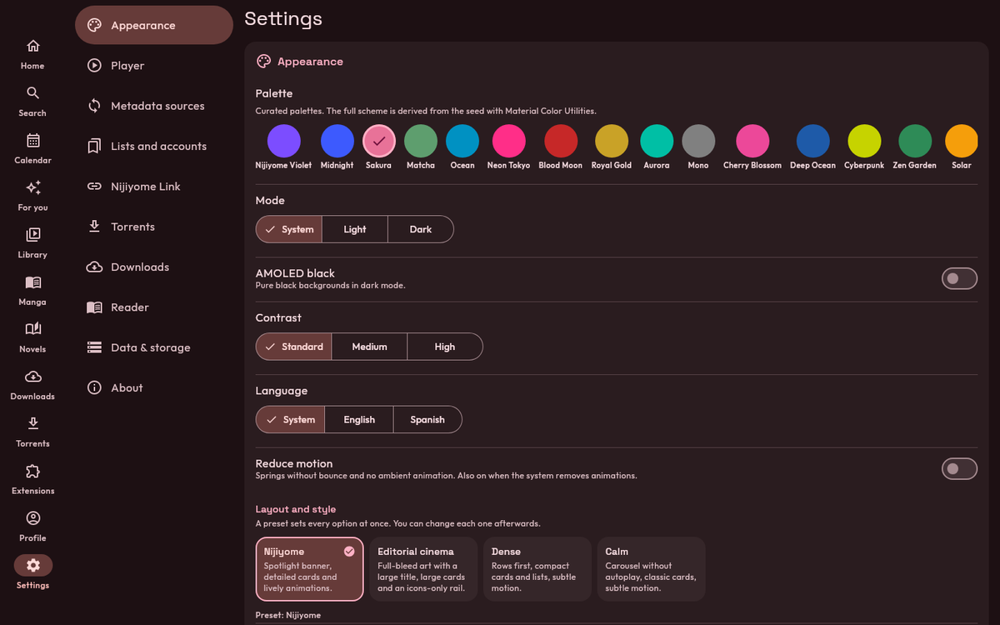

<div align="center">



# Nijiyome

**Anime, manga and novels for Android, Linux and Windows, with your own extensions and your AniList or MyAnimeList lists.**

**English** · [Español](README.es.md)

[](https://github.com/Kushro/Nijiyome/releases/latest)
[](LICENSE)


</div>

Nijiyome is one Kotlin + Compose Multiplatform codebase that runs on Android phones and tablets and on Linux and Windows
desktops. It plays video with libmpv, keeps your lists in sync with AniList or MyAnimeList, and gets its streams from `.kai`
extensions that you choose and install yourself. **The app ships no content.**

## 📸 Screenshots

<table>
  <tr>
    <td></td>
    <td></td>
  </tr>
  <tr>
    <td align="center"><sub>Home</sub></td>
    <td align="center"><sub>Details page and episode sources</sub></td>
  </tr>
  <tr>
    <td></td>
    <td></td>
  </tr>
  <tr>
    <td align="center"><sub>Settings › Player: upscaling shaders</sub></td>
    <td align="center"><sub>Built-in libmpv player (test clip, Spanish UI)</sub></td>
  </tr>
  <tr>
    <td></td>
    <td></td>
  </tr>
  <tr>
    <td align="center"><sub>Torrents › Debrid</sub></td>
    <td align="center"><sub>Extensions (description and domains covered)</sub></td>
  </tr>
  <tr>
    <td></td>
    <td></td>
  </tr>
  <tr>
    <td align="center"><sub>Manga</sub></td>
    <td align="center"><sub>Settings › Appearance (Sakura palette)</sub></td>
  </tr>
</table>

<sub>Desktop app 1.1.1 on Linux, fresh profile, no account linked. Cover art comes from AniList. The player screenshot is from
an earlier development build.</sub>

## ✨ Features

- 🧩 **`.kai` extensions.** Install a package from a file, a link or a repository (`index.json`), with its declared domains
  shown before you use it. Extensions made for Tatakai keep working. Stremio addon manifests can be added too.
- 📋 **AniList and MyAnimeList.** Link your account to sync lists and progress; discovery, calendar and details come from
  AniList and other metadata sources.
- 🎬 **libmpv player.** Full ASS subtitles, deband and image options, and upscaling shaders: Anime4K (several modes and
  quality levels), FSR, FSRCNNX, CAS and NVScaler, with automatic step-down when the GPU cannot keep up.
- ⚡ **Hardware decoding.** VAAPI on Linux (the settings show what your GPU can decode); software decoding as a fallback.
- 🪟 **External mpv.** Play in mpv's own window with your mpv config, including frame generation with
  [lsfg-vk](https://github.com/PancakeTAS/lsfg-vk) on Linux.
- 🧲 **Torrents.** Built-in libtorrent client with streaming while downloading, plus library, downloads, history, files,
  peers and trackers views. On Linux it needs glibc 2.38 or newer.
- ☁️ **Debrid.** TorBox is the recommended, tested service (cache lookups, downloads over HTTPS). Real-Debrid, AllDebrid and
  Premiumize are available and marked *experimental · untested*. API keys are stored encrypted, with the key in the system
  keyring.
- ⬇️ **Downloads and local library.** HLS and direct file downloads for offline viewing.
- 📖 **Manga and novel readers.** Novels include a narrator with system voices or KittenTTS on desktop.
- 🔗 **Nijiyome Link.** Pair your phone with your PC: the PC can process the video for the phone (upscaling, frame generation
  where available) and your watch history stays in sync.
- 🕵️ **Hidden browser for embed sources (desktop).** For sites that need a real browser, Nijiyome drives your installed
  Chrome, Edge or Chromium in the background through the DevTools protocol. Nothing is bundled.
- 🌐 **Network.** Outbound proxy (HTTP or SOCKS5, with credentials) and FlareSolverr support.
- 🖥️ **Desktop integration.** System tray, Discord Rich Presence and MPRIS media controls on Linux.
- 🎨 **Make it yours.** Curated Material 3 palettes, light / dark / AMOLED, contrast levels, layout presets, English and
  Spanish.

## 📦 Download and install

Everything is on the [Releases](https://github.com/Kushro/Nijiyome/releases/latest) page, with a `SHA256SUMS.txt` to check
the files.

| Platform | File | Notes |
|---|---|---|
| 🤖 Android 8.0+ | `Nijiyome-v1.1.1-android-arm64-v8a.apk` | Most phones from the last years. |
| | `Nijiyome-v1.1.1-android-armeabi-v7a.apk` | Older 32-bit phones. |
| | `Nijiyome-v1.1.1-android-x86_64.apk` | Emulators and x86 devices. |
| | `Nijiyome-v1.1.1-android-universal.apk` | Any device, larger download. If unsure, pick this one. |
| 🐧 Linux x86_64 | `Nijiyome-v1.1.1-linux-x86_64.AppImage` | `chmod +x` it and run it. Torrents need glibc 2.38+ (Ubuntu 24.04, Fedora 39, Arch and newer). |
| 🪟 Windows x64 | `Nijiyome-v1.1.1-windows-x64-setup.exe` | Installer; can register `nijiyome:` links and offer itself for `magnet:` / `.torrent`. |
| | `Nijiyome-v1.1.1-windows-x64-portable.zip` | Unzip and run; data still goes to `%APPDATA%\Nijiyome`. |

On Arch / CachyOS you can also build a package with the `PKGBUILD` in [`packaging/linux`](packaging/linux) (see
[`packaging/README.md`](packaging/README.md)).

After installing, add an extension in **Extensions** and, if you want, link AniList or MyAnimeList in
**Settings › Lists and accounts**.

## 🧩 Extensions

Nijiyome does not include, host or recommend any content source. Extensions are third-party `.kai` packages: install only
extensions you trust, from sources you trust. Each one runs in an embedded JavaScript engine (QuickJS), and the app shows the
domains it declares before you use it. The host API is documented in [`contracts/extension-host`](contracts/extension-host).

## 🛠️ Building from source

Requirements: JDK 21, the Android SDK (platform 37, build-tools 36.0.0, NDK 28.2.13676358, CMake 3.22.1) and Node 22 or newer
for the contract tests.

```sh
cp local.properties.example local.properties   # then fill in sdk.dir
./gradlew verificar                            # every unit test, the debug APK and the desktop distribution
./gradlew :desktopApp:run                      # run the desktop app
./gradlew :app:assembleDebug                   # only the Android debug APK
./gradlew :desktopApp:createReleaseDistributable  # desktop app image (input for the AppImage and Windows packages)
node --test tokens/test/*.test.mjs contracts/test/*.test.mjs
```

The AniList and MyAnimeList OAuth client ids are optional; without them "Link" is disabled. Set them in `local.properties` or
through environment variables (`NIJIYOME_ANILIST_CLIENT_ID`, `NIJIYOME_MAL_CLIENT_ID`; the desktop ones are listed in
[`packaging/README.md`](packaging/README.md)), where you will also find how the AppImage and the Windows installer are built.

<details>
<summary>Repository layout</summary>

| Path | What it is |
|---|---|
| `app/` | Android app (`app.nijiyome`) |
| `desktopApp/` | Desktop app (Linux, Windows) |
| `core/`, `feature/` | Logic and screen modules, shared by both apps |
| `server/` | Desktop servers: Nijiyome Link (mTLS) and the integrated extension server |
| `build-logic/` | Gradle convention plugins |
| `contracts/` | Shared contracts: extension host, Nijiyome Link v1 (OpenAPI), fixtures |
| `tokens/` | Design tokens: `tokens.json` → `Tokens.kt` |
| `native/temple-lsfg/` | Frame generation helper (C++/Vulkan) for Nijiyome Link |
| `packaging/` | Desktop packaging (AppImage, Arch package, Windows installer and portable zip) and icons |
| `scripts/` | Build and migration tools |

The migration plan (in Spanish) is in [`docs/plan-migracion.md`](docs/plan-migracion.md).

</details>

## 🦊 Origin

Nijiyome continues Tatakai Next 0.4.2, by the same author (`Kushro/Tatakai-own@196bfe89`), with a new identity and a single
codebase for every platform. Code comments that cite `docs/redesign/…` or `apps/desktop-native/…` refer to documents and
sources in that repository.

`.kai` extensions made for Tatakai keep working: the host keeps the former names of its global functions as aliases (see
[`contracts/extension-host/globals.v1.md`](contracts/extension-host/globals.v1.md)).

## 🤖 About AI

I'm a software developer by profession, and I use AI as a tool during development, both for the code and for the visuals.
Every feature, the architecture and every design decision in Nijiyome are mine, and everything that goes into the app is
reviewed and approved by me personally. The AI doesn't make the calls; it helps me build what I have in mind. My priority is
always security, performance and quality, and every release goes through automated tests, independent reviews and manual
testing on real devices before it's published. I'm working on this alone for now, without an artist or a designer, so the
icon and the visuals you see were made with AI help. When I find someone to work with who can take the visual side to the
level it deserves, those parts may be redone. If AI in an app is a dealbreaker for you, I completely understand, no hard
feelings. And if it isn't, I'd love for you to give it a try.

— Octavio ([Kushro](https://github.com/Kushro))

## 📄 License

Nijiyome is free software under the **GNU Affero General Public License v3.0 or later**. See [`LICENSE`](LICENSE).
Third-party code and libraries, with their licenses, are listed in [`THIRD_PARTY_NOTICES.md`](THIRD_PARTY_NOTICES.md).

## ⚠️ Disclaimer

Nijiyome is not affiliated with, endorsed by or sponsored by AniList, MyAnimeList, TorBox, Real-Debrid, AllDebrid, Premiumize
or any content site. It does not host, store or distribute any content. Extensions are made by third parties; you are
responsible for what you install and for complying with the laws of your country. Names and cover art belong to their
respective owners.
